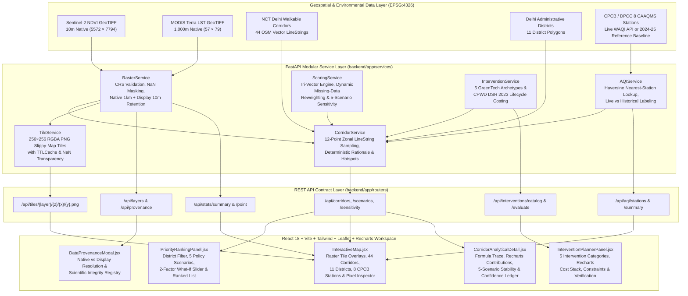

# VanSetu GreenTech — System Architecture (`docs/ARCHITECTURE.md`)

## 1. High-Level Architectural Overview

VanSetu GreenTech follows a decoupled, service-oriented geospatial architecture separating raster/vector scientific computation in Python (FastAPI) from interactive cartographic and analytical visualization in React (Vite + Tailwind CSS + Leaflet + Recharts).

---

## 2. Backend Service Responsibilities

| Service Module | File | Core Responsibilities |
| :--- | :--- | :--- |
| **RasterService** | `backend/app/services/raster_service.py` | Loads `delhi_ndvi_10m.tif` and `delhi_lst_modis_daily_celsius.tif`, validates `EPSG:4326` CRS, masks `nodata`/sentinel values to `np.nan`, preserves both the `57 × 79` native 1km LST array (`lst_native`) and the `5572 × 7794` bilinearly aligned 10m display array (`lst`), and computes the composite Green Deficit Index (`gdi`) with strict `NaN` propagation. |
| **AQIService** | `backend/app/services/aqi_service.py` | Manages the 8 CPCB/DPCC monitoring stations across NCT Delhi. Queries live WAQI telemetry when `WAQI_TOKEN` is configured; otherwise serves documented 2024–2025 CPCB seasonal reference baselines explicitly tagged with `is_live: false` and `data_mode: "historical_reference_baseline"`. Performs Haversine nearest-station assignment (`get_aqi_at_point`). |
| **ScoringService** | `backend/app/services/scoring_service.py` | Implements the explainable 6-factor Priority Score (`heat`, `green_deficit`, `pollution`, `pedestrian`, `health_risk`, `vulnerable_pop`), Implementation Feasibility score, and Evidence Confidence ledger. Dynamically re-normalizes active weights when any input is `None`/`NaN` (never coercing missing data to `0.0`). Executes comparative sensitivity analysis across all 5 policy scenarios. |
| **InterventionService** | `backend/app/services/intervention_service.py` | Evaluates corridor suitability $[0, 1]$ across the 5 GreenTech intervention categories (*Linear Street Trees*, *Architectural Shade Structures*, *Roadside Bioswales*, *Living Green Walls*, *Cool Pavements*) and computes CPWD DSR 2023 CapEx, Annual OpEx, mortality replacement allowances, and 5-year lifecycle costs scaled by corridor length. |
| **CorridorService** | `backend/app/services/corridor_service.py` | Enriches the 44 OSM walkable road corridors by sampling 12 evenly spaced points along each `LineString` against native and display rasters, attaching nearest CPCB station data, running `ScoringService` and `InterventionService`, and providing deterministic mathematical ranking explanations (`explain_corridor`) as well as raster connected-component hotspot detection (`get_raster_priority_zones_geojson`). |
| **TileService** | `backend/app/services/tile_service.py` | Converts Web Mercator slippy-map tile coordinates `(z, x, y)` to WGS84 bounding boxes, slices the requested raster (`ndvi`, `lst`, `gdi`, `corridors`), applies scientific colormaps (`YlGn`, `inferno`, `RdYlGn_r`, `magma`), preserves `NaN` pixels as transparent (`alpha = 0`), and caches rendered 256×256 PNGs in a `TTLCache`. |

---

## 3. Frontend Component Architecture

The frontend (`frontend/src/`) is designed as a three-column, map-first environmental decision-support workspace built with **React 18**, **Vite 5**, **Tailwind CSS 3**, **Leaflet / React-Leaflet**, and **Recharts 2**:

1. **Top Telemetry Header (`App.jsx`):** Displays city-wide native 1km MODIS LST mean, 10m Sentinel-2 NDVI mean, 8-station CPCB AQI mean (with explicit live vs. historical baseline tag), and opens the **Scientific Data Provenance & Integrity Modal** (`DataProvenanceModal.jsx`).
2. **Left Column — Prioritization & Scenario Controls (`PriorityRankingPanel.jsx`):**
   - District selector across all 11 NCT Delhi administrative districts + corridor search bar.
   - 5-Scenario policy switcher (*Baseline*, *Heat-Resilience*, *Air-Quality*, *Pedestrian-Equity*, *Extreme-Vulnerability*).
   - Interactive 2-factor What-If sensitivity slider (`heat_weight` in $[0, 1]$).
   - Scrollable ranked corridor list with $\Delta\text{Rank}$ shift badges vs. Baseline.
3. **Center Column — Interactive Cartographic Canvas (`InteractiveMap.jsx`):**
   - Slippy-map raster overlays (`GDI`, `LST`, `NDVI`) with opacity slider and native-vs-display resolution legend card.
   - Interactive vector layers for the 44 walkable corridors, 11 district boundaries, raster connected-component hotspots, and 8 CPCB stations.
   - Click-anywhere **Geospatial Pixel Inspector** querying `/api/stats/point` to compare un-interpolated 1km MODIS LST against 10m display LST and 10m NDVI.
4. **Right Column — Explainable Analytics & Intervention Planner (`CorridorAnalyticalDetail.jsx` & `InterventionPlannerPanel.jsx`):**
   - **Score & Scenarios Tab:** Displays the Tri-Vector cards, native vs. display corridor measurements, exact mathematical `formula_trace`, Recharts horizontal bar chart of weighted factor contributions, 5-scenario comparative bar chart, Stability Index $S \in [0, 1]$, and the Evidence Confidence deduction ledger.
   - **Interventions (5) Tab:** Displays all 5 GreenTech intervention categories ranked by suitability, a Recharts stacked bar chart comparing CapEx vs. 5-Year OpEx across the 5 archetypes, CPWD DSR 2023 line-item breakdowns, native Delhi species lists, site constraints, required pre-installation verification checklists, and evidence/confidence limitations.
   - **Districts (11) Tab:** Displays the district-level aggregation matrix across all 11 NCT Delhi administrative districts.
