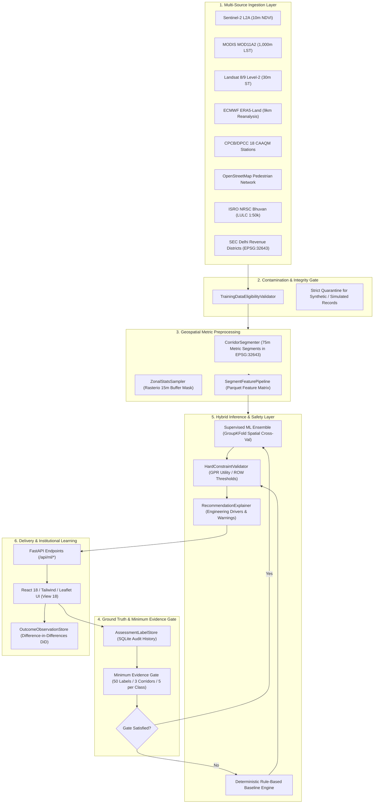

# VanSetu GreenTech — Intervention Intelligence ML Architecture

## 1. System Vision & Purpose

VanSetu GreenTech’s Machine Learning Pipeline provides an **AI-powered intervention intelligence engine** for National Capital Territory (NCT) Delhi. It shifts municipal climate planning from heuristic scoring and aggregate corridor rankings to **road-segment-level feasibility prediction, explainable decision-support, and empirical outcome learning**.

The system addresses the fundamental municipal question:
> **"For this specific 75-metre road segment in Delhi, which urban climate intervention is physically viable, environmentally justified, and legally compliant — and what evidence proves it?"**

---

## 2. End-to-End Architectural Data Flow

---

## 3. Component Directory Breakdown

| Component Path | Responsibility | Implementation Standard |
| :--- | :--- | :--- |
| `backend/ml/security/` | Server-side RBAC security & authentication | Salted SHA-256 token hashing, credential lifecycle (create, rotate, revoke), rate limiting, zero plaintext tokens. |
| `backend/ml/validation.py` | Training data quarantine & contamination validator | Zero-synthetic policy; rejects `is_simulated=1` and circular model scores. |
| `backend/ml/sources/` | 8 Standardized data adapters | Explicit CRS, native resolutions, provenance, `CATALOGUE_METADATA_RETRIEVED` vs `LIVE_DATA_FETCHED`. |
| `backend/ml/preprocessing/segmentation.py` | 75m Metric road segmentation | Computes in `EPSG:32643` (UTM 43N) to prevent metric distortion; outputs `EPSG:4326`. |
| `backend/ml/preprocessing/zonal_stats.py` | Rasterio buffer zonal statistics | True pixel counts, valid pixel fractions, and NoData transparency. |
| `backend/ml/preprocessing/feature_pipeline.py` | 1,302 Delhi road segments feature dataset | Generates Parquet and GeoJSON with strict 7-class feature provenance tags. |
| `backend/ml/labels/` | Field assessment schema & evidence store | Binary uploads (PDF/PNG/JPEG <= 10MB, magic-byte checks), evidence lifecycle, self-approval prevention. |
| `backend/ml/training/data_builder.py` | Dataset builder & spatial GroupKFold | Implements non-negotiable minimum evidence gate (`min_labels=50`, `min_corridors=3`, verified disk doc check). |
| `backend/ml/training/suitability_trainer.py` | Spatial cross-validation model trainer | Spatial GroupKFold; disqualifies models with >5% false eligible rate; sets EXPERIMENTAL status. |
| `backend/ml/training/spaces_storage.py` | Durable object storage adapter (Spaces) | S3 client with SHA-256 pre/post transfer verification and graceful local volume fallback. |
| `backend/ml/training/registry.py` | Model versioning & governance lifecycle | SHA-256 artifact hashing, RBAC promotion, Spaces durable store sync, and zero-downtime rollback. |
| `backend/ml/inference/hard_constraints.py` | Deterministic hard engineering constraints | Physical safety overrides: 4 canonical states; guideline width never forces INELIGIBLE (only measured widths). |
| `backend/ml/inference/explanation.py` | Engineering recommendation explainer | Environmental drivers, limiting constraints, and missing survey warnings. |
| `backend/ml/inference/predictor.py` | Predictor & multi-criteria ranker | Orchestrates ML classifier with rule-based fallback and policy objectives. |
| `backend/ml/outcome/` | Empirical outcome telemetry & causal learning | Pre/post difference-in-differences schema with matched control sites; baseline collection only. |
| `backend/app/routers/ml_interventions.py` | FastAPI router (14 endpoints) | Exposes predictions, features, label submissions, binary evidence uploads, reviews, promotions, and rollbacks. |
| `frontend/src/components/InterventionIntelligenceView.jsx` | React municipal planning interface | Interactive inspection, feature exploration, dynamic token entry, and binary evidence upload. |

---

## 4. The 5 GreenTech Intervention Classes

VanSetu models 5 physical urban climate interventions:
1. **`linear_street_trees`**: Continuous canopy planting along pedestrian footways (Min ROW: 2.5m; Cooling: 1.5–2.8°C).
2. **`roadside_bioswales`**: Vegetated stormwater bioretention channels (Min ROW: 2.0m; Waterlogging mitigation + 0.8–1.4°C cooling).
3. **`architectural_shade_structures`**: Tensile solar-reflective pedestrian canopies (Min ROW: 1.8m; Cooling: 2.0–3.5°C).
4. **`high_albedo_cool_pavements`**: High-solar-reflectance permeable/semi-permeable coatings (Min ROW: 1.2m; Albedo $\ge 0.40$; Cooling: 1.2–2.2°C).
5. **`living_green_walls`**: Vertical modular vegetated facade screens (Min ROW: 1.0m; Particulate capture + 1.0–1.8°C localized cooling).

---

## 5. Non-Negotiable Scientific Principles

1. **Zero Data Fabrication**: Training datasets are never populated with synthetic records, random numbers, or simulated time-series.
2. **Minimum Evidence Gate**: If human-verified field ground-truth is under 50 labels across 3 corridors, the system reports `MODEL_NOT_TRAINABLE_INSUFFICIENT_VERIFIED_LABELS` and falls back to `DETERMINISTIC_RULE_BASED_ENGINE`.
3. **Safety Constraints Override ML**: Machine learning predictions can never override physical subsurface utility conflicts (GPR surveys) or inadequate road right-of-way.
4. **Spatial Leakage Prevention**: Cross-validation uses grouped spatial splits (`GroupKFold` by corridor and district). Random K-Fold is strictly forbidden to prevent adjacent-segment autocorrelation leakage.
5. **Causal Outcome Learning**: Outcome evaluation requires pre/post deployment telemetry with matched control sites, tracking confounders (monsoon anomalies, traffic shifts).
