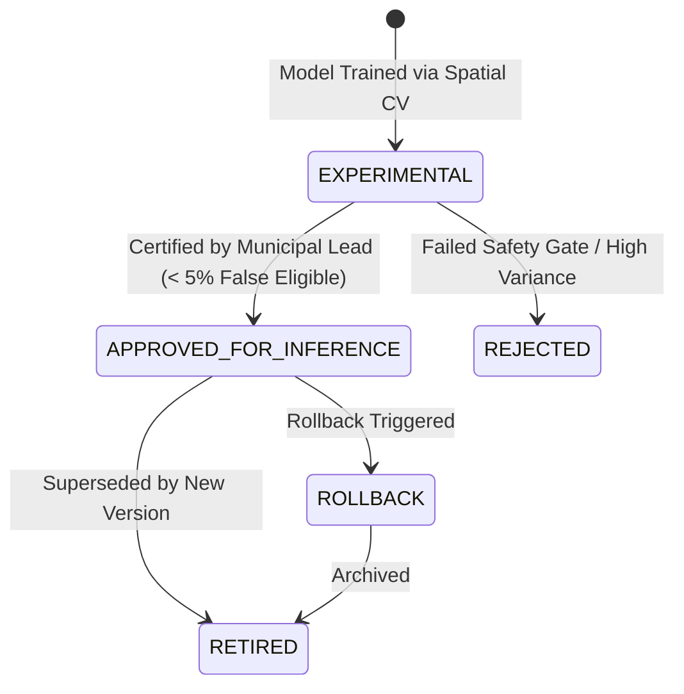

# VanSetu GreenTech — Machine Learning Model Governance & Registry Protocol

## 1. Governance Principles

Machine learning models deployed in VanSetu guide municipal capital expenditures and physical street modifications. The model governance framework guarantees:

1. **Reproducibility**: Every model artifact is linked to the exact Git commit, dataset version, and spatial CV split that produced it.
2. **Artifact Integrity**: Every trained model is fingerprinted with a cryptographically secure **SHA-256 checksum**. Any discrepancy between stored metadata and artifact bytes aborts inference immediately.
3. **Approval Lifecycle**: Models cannot self-deploy. Promotion to active inference requires explicit municipal approval.
4. **Deterministic Safe Fallback**: In the absence of an approved model or upon artifact corruption, the system rolls back seamlessly to the **Deterministic Rule-Based Engine**.

---

## 2. Model Lifecycle States



### Lifecycle Status Enums:
- `EXPERIMENTAL`: Model successfully trained and validated across spatial folds. Artifact serialized in `models/` with SHA-256 hash.
- `APPROVED_FOR_INFERENCE`: Officially approved by the municipal planning lead for live prediction. Loaded by `InterventionIntelligencePredictor`.
- `REJECTED`: Candidate model disqualified due to high False Eligible Rate ($> 5\%$) or poor spatial generalization.
- `RETIRED`: Archived previous production model preserved for historical audit trails and back-testing.

---

## 3. Model Metadata Schema (`latest_model_metadata.json`)

```json
{
  "model_version": "v1.2.0-20261031-HGB",
  "archetype": "all_archetypes",
  "approval_status": "APPROVED_FOR_INFERENCE",
  "model_architecture": "HistGradientBoostingClassifier",
  "trained_at": "2026-10-31T14:30:00Z",
  "git_commit": "ae8c964d84f880fcfc30",
  "dataset_version": "2.0.0-DELHI-ML",
  "training_labels_count": 84,
  "corridors_count": 6,
  "artifact_filename": "intervention_suitability_hgb_v1.2.0.joblib",
  "artifact_sha256": "e3b0c44298fc1c149afbf4c8996fb92427ae41e4649b934ca495991b7852b855",
  "validation_metrics": {
    "macro_f1": 0.812,
    "balanced_accuracy": 0.825,
    "false_eligible_rate": 0.024,
    "spatial_cv_folds": 5
  },
  "approved_by": "CHIEF_TOWN_PLANNER_DELHI",
  "approval_notes": "Meets sub-5% false-eligibility criteria across all 5 spatial validation folds."
}
```

---

## 4. Integrity Verification & Zero-Downtime Rollback

### Integrity Check:
At model load time, `ModelRegistry` reads the artifact bytes and recalculates its SHA-256 hash:
$$\text{computed\_hash} = \text{SHA256}(\text{artifact\_bytes})$$
If $\text{computed\_hash} \ne \text{artifact\_sha256}$, the registry logs a security critical alert:
`MODEL_ARTIFACT_CORRUPTED_OR_TAMPERED`
and immediately disables the model, activating the deterministic rule-based engine.

### Zero-Downtime Rollback Procedure:
If a newly approved model demonstrates unexpected predictions in the field:
1. The administrator invokes `POST /api/ml/model/rollback` or updates `latest_model_metadata.json` with the previous version's metadata.
2. The runtime cache reloads the previous approved `.joblib` artifact.
3. If no prior artifact is available, the system falls back to `RULE_BASED_FALLBACK_v1.0` without process restarts or service downtime.
