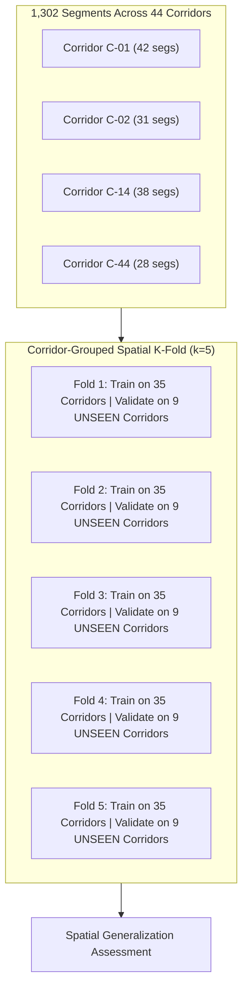

# VanSetu GreenTech — Machine Learning Training & Spatial Validation Protocol

## 1. Spatial Autocorrelation & The Data Leakage Problem

In urban geospatial modeling, adjacent road segments are strongly spatially autocorrelated:
- Segment `C-14-S001` and `C-14-S002` share nearly identical satellite NDVI values, surface temperatures, traffic profiles, and administrative context.
- Conventional random train-test splitting (e.g., standard $k$-fold cross-validation) places `C-14-S001` in the training set and `C-14-S002` in the test set. The model merely "memorizes" the corridor location rather than learning genuine causal suitability rules. This leads to artificially inflated validation metrics that collapse upon deployment to new corridors.

---

## 2. Spatial Cross-Validation Strategy (`GroupKFold`)

To prevent spatial data leakage, VanSetu implements **grouped spatial cross-validation**:

### Protocol Rules:
1. **Grouping Variable**: `corridor_id`. All segments of any given corridor belong exclusively to the training fold or exclusively to the validation fold.
2. **District Block Out**: In advanced verification, geographic leave-one-district-out (LODO) validation isolates entire revenue districts (e.g., train on 10 districts, evaluate on North West Delhi).

---

## 3. The Non-Negotiable Minimum Evidence Gate

A core scientific integrity rule of VanSetu is:
> **Never train a machine learning model on synthetic labels or heuristic self-supervision.**

Before any model training begins, `TrainingDatasetBuilder.check_minimum_data_gate()` audits available verified labels against the following strict thresholds:

| Criterion | Minimum Threshold | Rationale |
| :--- | :--- | :--- |
| **Total Verified Labels** | $\ge 50$ field-surveyed labels | Statistical power threshold for 3-class classification. |
| **Distinct Corridors** | $\ge 3$ distinct road corridors | Minimum requirement to establish spatial cross-validation folds. |
| **Labels per Class** | $\ge 5$ in each class (`ELIGIBLE`, `CONDITIONAL`, `INELIGIBLE`) | Prevents degenerate single-class majority classifiers. |

### Operational Fallback:
If the gate is unsatisfied, the system **strictly halts training**, issues code:
`MODEL_NOT_TRAINABLE_INSUFFICIENT_VERIFIED_LABELS`
and serves predictions using the **Deterministic Rule-Based Baseline Engine**. It displays the exact audit count in the user interface.

---

## 4. Evaluated Model Architectures

When the minimum evidence gate is passed, the training pipeline (`SuitabilityModelTrainer`) trains and compares four diverse architectures under the exact same grouped spatial CV folds:

1. **Regularized Multinomial Logistic Regression**:
   - Linear baseline with $L_2$ regularization.
   - Interpretable coefficients representing marginal log-odds per feature.
2. **Random Forest Classifier**:
   - Ensemble of 100 decorrelated decision trees (`max_depth=8`, `min_samples_leaf=3`).
   - Resistant to outliers and monotonic feature transformations.
3. **ExtraTrees Classifier (Extremely Randomized Trees)**:
   - Randomizes split thresholds to further reduce spatial variance.
4. **Histogram-based Gradient Boosting (`HistGradientBoostingClassifier`)**:
   - Native handling of missing values without pre-imputation leakage.
   - High expressive capacity for non-linear interactions.

---

## 5. Evaluation Metrics & The "False Eligible" Safety Penalty

Standard classification accuracy is misleading in urban infrastructure planning due to severe class imbalance. VanSetu evaluates models against three safety-oriented metrics:

### 1. Macro-Averaged $F_1$ Score
$$\text{Macro } F_1 = \frac{1}{3} \sum_{c \in \{\text{ELIGIBLE}, \text{CONDITIONAL}, \text{INELIGIBLE}\}} F_{1, c}$$
Ensures that minority classes (e.g., constrained sites) are weighted equally with common sites.

### 2. Balanced Accuracy
Average of recall obtained on each class, guarding against majority-class collapse.

### 3. False Eligible Rate (Safety Critical Metric)
$$\text{False Eligible Rate} = \frac{\text{False Positives for ELIGIBLE}}{\text{Total Actual INELIGIBLE}}$$
Predicting that a physically obstructed or unsafe site is `ELIGIBLE` could cause underground utility ruptures or project cancellation. A candidate model is **disqualified from promotion** if its False Eligible Rate exceeds $5.0\%$, regardless of its overall accuracy.
