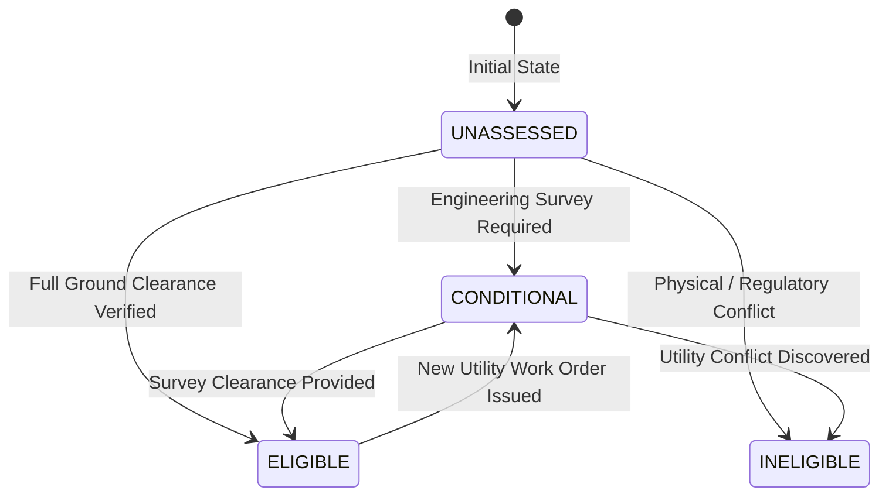

# VanSetu GreenTech — Intervention Suitability Field Label Guidelines

## 1. Purpose & Scope

This protocol defines the standard operating procedure for municipal field engineers, urban foresters, transport planners, and public works assessors evaluating the suitability of Delhi road segments for urban climate interventions.

Ground-truth labels collected under this protocol serve as the **verified training data** for VanSetu’s supervised machine learning models.

---

## 2. The 4-State Suitability Ontology

Every road segment ($75\text{m}$ length) must be classified into exactly one of four distinct states for each of the five GreenTech intervention archetypes:

### 1. `ELIGIBLE`
- **Definition**: The segment satisfies all physical, spatial, environmental, and engineering requirements.
- **Criteria**:
  - Clear sidewalk / verge width meets or exceeds minimum archetype threshold.
  - Subsurface utilities verified clear to minimum excavation depth via GPR survey or official municipal drawings.
  - Safe pedestrian envelope preserved ($\ge 1.8\text{m}$ clear walkway remaining post-intervention).
  - No heritage protection order, high-speed motorway prohibition, or conflicting infrastructure project active.
- **Evidence Requirement**: Official survey reference number, GPR clearance certificate, or signed municipal work order.

### 2. `CONDITIONAL`
- **Definition**: The segment has environmental justification (elevated heat, low canopy, or flood risk), but implementation is contingent upon specific field verifications, utility relocations, or structural modifications.
- **Criteria**:
  - GPR survey pending for deep-excavation archetypes.
  - Pavement sub-base structural testing required for cool pavement applications.
  - Façade structural load-bearing verification needed for living green walls.
  - Seasonal maintenance or dedicated irrigation supply agreement pending.
- **Action**: Generates an actionable field requisition in the municipal planning workflow.

### 3. `INELIGIBLE`
- **Definition**: The segment cannot accommodate the intervention due to insurmountable physical, legal, or safety constraints.
- **Mandatory Rejection Conditions**:
  - **Right-of-Way Bottleneck**: Measured physical sidewalk width (`surveyed_row_width_m`, `clear_pedestrian_width_m`, `available_planting_verge_m`) is strictly less than the minimum required. *Note: Guideline-only roadway width (`road_class_guideline_row_m`) cannot trigger ineligibility; it flags CONDITIONAL_PENDING_INSPECTION.*
  - **Subsurface Utility Conflict**: High-voltage electrical conduits, main water trunk lines, metro tunneling, or gas pipelines within $1.5\text{m}$ depth verified via GPR.
  - **Pedestrian Safety Hazard**: High-speed arterial/motorway corridor without physical separation from vehicular traffic.
  - **Heritage Restriction**: Archaeological Survey of India (ASI) regulated buffer forbidding ground disturbance.

### 4. `UNASSESSED`
- **Definition**: No accredited municipal engineer or field surveyor has inspected the site.
- **Data Policy**: **Strictly quarantined from ML training matrices**. An unassessed segment cannot serve as a negative or positive training target.

---

## 3. Evidence Document Lifecycle & Binary Uploads

To eliminate evidence verification bypasses, string matching and heuristic pattern parsing have been completely removed:
1. **Binary Document Upload**: Supporting evidence must be uploaded as a binary file (`POST /api/ml/evidence/upload`) with strict magic-byte validation (PDF `%PDF-`, PNG `\x89PNG`, JPEG `\xff\xd8\xff`) and a size limit of $\le 10\text{ MB}$.
2. **Cryptographic Fingerprint**: A deterministic SHA-256 hash is computed and stored with file metadata in `evidence_documents`.
3. **Formal Verification Lifecycle**: Documents progress through explicit states:
   - `EVIDENCE_NOT_PROVIDED`
   - `EVIDENCE_UPLOADED_UNVERIFIED`
   - `EVIDENCE_PENDING_REVIEW`
   - `EVIDENCE_VERIFIED`
   - `EVIDENCE_REJECTED`
4. **Independent Reviewer Sign-Off**: Verification requires an accredited municipal reviewer (`VERIFY_EVIDENCE` permission) who is **not** the uploader.
5. **Training Eligibility**: A label is only training-eligible if its linked document has status `EVIDENCE_VERIFIED`, the binary file exists on disk, and its real SHA-256 matches the recorded checksum.

---

## 4. Reviewer Provenance & Audit Protocol

To prevent ground-truth contamination, every label submission is validated through the server-side RBAC security layer:
1. `assessor_id` & `organization`: Injected strictly from the server-verified Bearer token session. Client-supplied role strings are ignored to prevent privilege escalation.
2. `evidence_document_type`: Must be categorized as one of the following recognized institutional classes:
   - `GPR_UTILITY_SURVEY` (Ground-penetrating radar scan report)
   - `MUNICIPAL_WORK_ORDER` (Signed departmental sanction order)
   - `ENGINEERING_CROSS_SECTION` (Measured total and pedestrian ROW)
   - `TREE_CENSUS_REGISTER` (Official municipal tree census)
   - `HERITAGE_RESTRICTION_CIRCULAR` (ASI / DUAC circular)
   - `UNVERIFIED_TEXTUAL_NOTE` (Demoted to unverified; excluded from ML training)
3. `evidence_reference`: Verifiable official document ID (e.g., `PWD/2026/GPR-7701`, `MCD/HORT/W-12/2026`).
4. `engineering_constraints`: Specific structured notes regarding subsurface conditions, ROW dimensions, or traffic patterns.

### Label Governance & Review Lifecycle
- **Level 1 (Field Submission)**: Initiated by an accredited `FIELD_ASSESSOR`. Status = `PENDING_REVIEW`.
- **Level 2 (Senior Approval)**: Review by an authorized `AUTHORIZED_REVIEWER`, `SENIOR_REVIEWER`, or `ADMINISTRATOR` -> Status = `APPROVED`.
- **Prohibition of Self-Approval**: A field assessor is strictly prohibited by code from approving their own submitted assessment. Attempted self-approvals raise a Conflict of Interest violation and are rejected.
- **Immutable Audit Trail**: All state transitions, reviewer notes, and previous statuses are retained immutably in `assessment_audit_history`.
- Only `APPROVED` assessments backed by verifiable documents (`is_evidence_verified == 1`) enter the ML training pipeline. All `PENDING_REVIEW` or unverified notes are strictly excluded.
