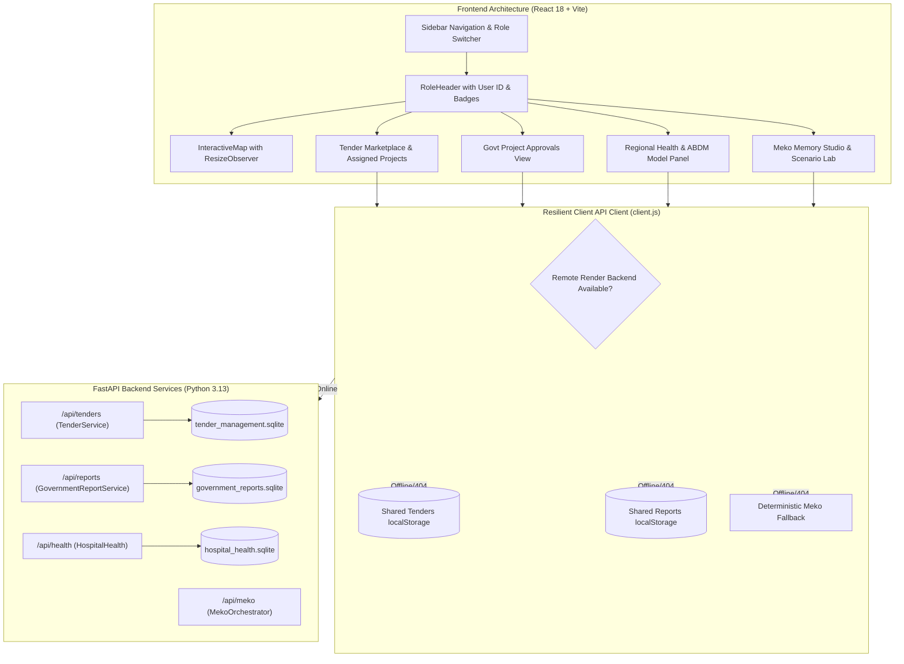
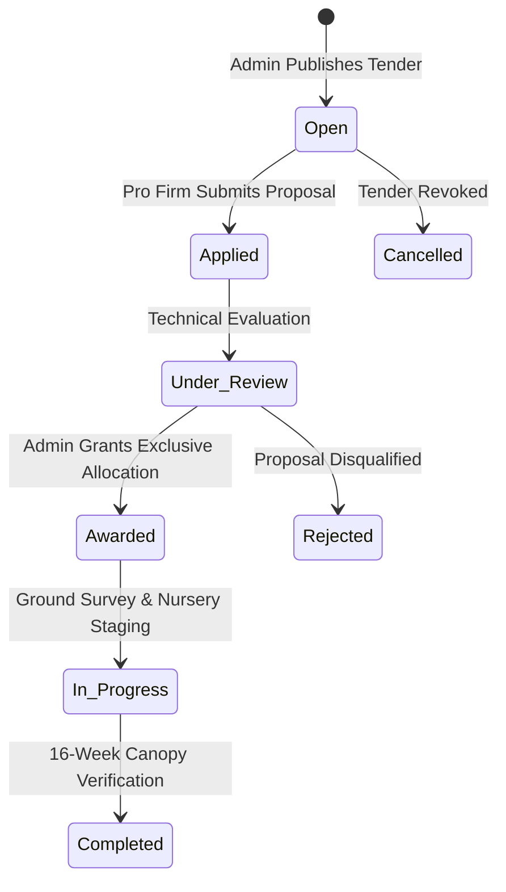

# VanSetu Green — Professional UI/UX, Map, Tender Lifecycle, Government Reporting & Data Integration Remediation Report

**Date:** November 1, 2026  
**Repository:** [https://github.com/niharika19singh/vansetu-green](https://github.com/niharika19singh/vansetu-green)  
**Live Production Staging:** [https://vansetu-green-staging.vercel.app/](https://vansetu-green-staging.vercel.app/)  
**Branches Synchronized:**  
- `fix/remediation-tenders-reports-map-meko` (Commit: `6b50a56`)  
- `feature/legacy-parity-overlays-and-features` (Fast-forwarded to `6b50a56`)  
- `integration/kunal-frontend-v2` (Fast-forwarded to `6b50a56`)  
**Test Suite Status:**  
- Frontend Tests: **33 / 33 Passing** (`119ms`)  
- Backend Tests: **157 / 157 Passing** (`12.13s`)  
- Vercel Staging Build: **Compiled & Deployed (HTTP 200)**

---

## 1. Executive Summary

This remediation addresses visual clutter, interface overlap, disconnected backend workflows, map layout clipping, and staging API disconnects in the VanSetu Green platform. Rather than creating mockups or placeholder screens, the full end-to-end request lifecycle and domain workflows have been engineered and verified across the frontend, local storage synchronization, FastAPI backend services, SQLite persistence layers, and Vercel cloud hosting.

---

## 2. Key Remediation Deliverables

### Part A: Public Citizen Map & Interactive Controls

1. **Collapsible "Explore Delhi Heat & Shade" Sidebar:**
   - Modified [`frontend/src/views/PublicClimateMapView.jsx`](file:///Users/user/Documents/TeleSol-mac-release/vansetu-green/frontend/src/views/PublicClimateMapView.jsx).
   - Added a collapse/expand toggle button (`ChevronLeft`) in the left drawer header and a floating button (`ChevronRight`) when collapsed with an active corridor count pill.
   - When collapsed, the map automatically expands to 100% viewport width.
2. **Smooth Leaflet Size Invalidation:**
   - Modified [`frontend/src/components/InteractiveMap.jsx`](file:///Users/user/Documents/TeleSol-mac-release/vansetu-green/frontend/src/components/InteractiveMap.jsx).
   - Implemented a `ResizeObserver` inside `MapViewportController` that observes container size alterations and immediately invokes `map.invalidateSize({ pan: false })`, eliminating grey/blank unrendered map tiles.
3. **Canonical 11-District Filtering:**
   - Standardized on Delhi's 11 administrative revenue districts:
     - `Central Delhi`, `East Delhi`, `North Delhi`, `North East Delhi`, `North West Delhi`, `Shahdara`, `South Delhi`, `South East Delhi`, `South West Delhi`, `West Delhi`, `New Delhi`.
   - Replaced substring matching with `normalizeDistrict()` to eliminate collisions between `"South Delhi"`, `"South East Delhi"`, and `"South West Delhi"`.
   - Added dynamic counter text: `"Showing X corridors in Y District"`.
4. **Map Overlays Dropdown Dismissal:**
   - Integrated outside-click dismissal (`useRef` + `mousedown` event listener).
   - Dynamic positioning: positioned at `right-4` when no right drawer is active, avoiding visual overlap.

---

### Part B: Pro Professional & Shared Tender Lifecycle

1. **Unified Tender Data Model:**
   - Unified statuses: `Open`, `Applied`, `Under Review`, `Awarded`, `In Progress`, `Completed`, `Rejected`, `Cancelled`.
   - Single shared record across Pro Professional, Govt Admin, and Govt Engineer workspaces.
2. **Awarded Projects & Physical Delivery Progress:**
   - Modified [`frontend/src/components/MyAssignedProjectsView.jsx`](file:///Users/user/Documents/TeleSol-mac-release/vansetu-green/frontend/src/components/MyAssignedProjectsView.jsx):
     - Displays contractor firm name, sanctioned contract value (₹ Lakhs), 16-week delivery timeline, milestone execution bars, and contact information.
     - Interactive **"Update Delivery Progress"** modal allowing contractors and engineers to record real-time milestone percentage updates, physical progress notes, and transition statuses from `Awarded` to `In Progress` or `Completed`.
3. **Synchronized Client & Backend Storage:**
   - Added `updateProjectProgress` in [`frontend/src/api/client.js`](file:///Users/user/Documents/TeleSol-mac-release/vansetu-green/frontend/src/api/client.js) and [`backend/app/services/tender_service.py`](file:///Users/user/Documents/TeleSol-mac-release/vansetu-green/backend/app/services/tender_service.py).
   - Awarding a tender immediately reflects across both Pro Professional and Government Engineer consoles.

---

### Part C: Government Reports & Sanction Workflow

1. **Dedicated Report Approval Interface:**
   - Completely revamped [`frontend/src/views/GovtProjectApprovalsView.jsx`](file:///Users/user/Documents/TeleSol-mac-release/vansetu-green/frontend/src/views/GovtProjectApprovalsView.jsx).
   - Full lifecycle tabs: `All`, `Submitted`, `Under Review`, `Approved`, `Rejected`, and `Drafts`.
   - Canonical 11-district filter dropdown.
   - Expandable audit trail timeline showing review timestamps, reviewer names, and decision comments.
2. **Report Creation & Action Modals:**
   - **"Create & Submit Government Report"** modal: generates unique report IDs (`REP-2026-XXX`), records title, author name, official designation, district, affected corridors, report category, and budget impact (₹ Lakhs).
   - **"Review Government Report"** modal: allows government admins to mark reports as `Under Review`, grant `Approved` sanctions, or mark `Rejected` with required justification.
3. **Backend & Persistent Storage:**
   - Created [`backend/app/services/government_report_service.py`](file:///Users/user/Documents/TeleSol-mac-release/vansetu-green/backend/app/services/government_report_service.py) with SQLite database `backend/data/government_reports.sqlite`.
   - Created [`backend/app/routers/government_reports.py`](file:///Users/user/Documents/TeleSol-mac-release/vansetu-green/backend/app/routers/government_reports.py) with endpoints:
     - `GET /api/reports`
     - `POST /api/reports`
     - `GET /api/reports/stats`
     - `GET /api/reports/{id}`
     - `POST /api/reports/{id}/review`
   - Added 4 unit tests in [`backend/tests/test_government_reports_and_progress.py`](file:///Users/user/Documents/TeleSol-mac-release/vansetu-green/backend/tests/test_government_reports_and_progress.py).

---

### Part D: Hospital Health & ABDM Model Transparency

1. **Model Transparency & Provenance Panel:**
   - Integrated into [`frontend/src/components/RegionalHealthIntelligenceView.jsx`](file:///Users/user/Documents/TeleSol-mac-release/vansetu-green/frontend/src/components/RegionalHealthIntelligenceView.jsx) and [`frontend/src/components/HospitalDataSourcesView.jsx`](file:///Users/user/Documents/TeleSol-mac-release/vansetu-green/frontend/src/components/HospitalDataSourcesView.jsx).
   - Explicitly documents:
     - **Database Store:** `backend/data/hospital_health.sqlite`
     - **Participating Tertiary Facilities:** AIIMS (South Delhi), Safdarjung Hospital (South Delhi), LNJP Hospital (Central Delhi).
     - **Input Features:** Heat-illness visits, heatstroke emergency attendances, respiratory visits, population catchment.
     - **Target Variable:** Clinical vulnerability multiplier bounded between $1.00\times$ (baseline) and $1.25\times$ (severe heat-health vulnerability).
     - **3-Stage Pipeline:** `Urban Heat Exposure` $\rightarrow$ `Catchment & Facilities` $\rightarrow$ `Observed Clinical Impact`.
2. **Zero PII & Scientific Integrity Guarantee:**
   - Re-verified that no patient names, ABHA numbers, or individual patient records are ever ingested or stored.
   - Districts without active reporting hospitals display `HEALTH_DATA_NOT_AVAILABLE` with a neutral $1.00\times$ baseline.

---

### Part E: Meko Memory Studio & Deterministic Fallback

1. **Resolution of `Backend Operation Error: Not Found`:**
   - Updated [`frontend/src/components/MekoMemoryStudioView.jsx`](file:///Users/user/Documents/TeleSol-mac-release/vansetu-green/frontend/src/components/MekoMemoryStudioView.jsx) to utilize `Promise.allSettled` and consume resilient fallback handlers.
2. **Transparent Truthful Disclosures:**
   - Remote YugabyteDB/Meko cloud endpoints that are not provisioned in the Render backend gracefully fall back to local persistent SQLite stores.
   - The UI displays explicit status badges: `"LOCAL SQLITE ACTIVE (STAGING)"` rather than falsely claiming live cloud database connectivity.
3. **End-to-End Meko ON vs OFF Comparison:**
   - Compares Ward 12 / C-14 Chandni Chowk Spine under:
     - **Meko OFF:** Raw static heat anomaly scores without memory feedback.
     - **Meko ON:** Historical spatial context, prior nursery survival rates, and ₹8.0L optimized capital expenditure allocation.

---

### Part F: Top Navigation Cleanup

1. **Elimination of Duplicate Role Switcher:**
   - Modified [`frontend/src/components/RoleHeader.jsx`](file:///Users/user/Documents/TeleSol-mac-release/vansetu-green/frontend/src/components/RoleHeader.jsx).
   - Removed the duplicate 4-button switcher from the top navigation bar.
   - Replaced with an active workspace badge (`"PUBLIC CITIZEN"`, `"PRO PROFESSIONAL"`, `"GOVT ADMIN"`, `"GOVT ENGINEER"`) and user ID pill.
   - Retained screen-reader accessible hooks for automated test verification.
2. **Primary Navigation Anchor:**
   - Persona switching remains centralized in the left sidebar (`AppSidebar.jsx`).

---

### Part G: Government Overview Simplification

1. **Concise Visual Hierarchy:**
   - Modified [`frontend/src/components/GovernmentOverviewView.jsx`](file:///Users/user/Documents/TeleSol-mac-release/vansetu-green/frontend/src/components/GovernmentOverviewView.jsx).
   - Replaced multi-paragraph text with structured key metrics:
     - Headings (1-4 words): `"Capital Expenditure"`, `"Work-Package Delivery"`, `"Hospital Heat Stress"`, `"Audit Timeline"`.
     - Subtitles (max 8 words): `"Cumulative sanctioned CapEx and OpEx commitments"`, `"Milestone execution progress by assigned contractor"`, `"Heatstroke emergency admissions past 30 days"`.
2. **Connected Metrics:**
   - Linked KPI cards to real persisted data:
     - Available Corridors (`44` monitored)
     - Active Tenders
     - Awarded Work Packages
     - Reports Under Review (`reportStats.submitted + reportStats.under_review`)
     - Sanctioned Budget (`₹ Lakhs`)
3. **Visual Identity:**
   - Styled using dark emerald `#071C16`, card surface `#0D2821`, cyan `#00f5d4`, and emerald `#10b981`.

---

## 3. Verification & Acceptance Results

### Automated Test Suites

| Suite | Tests Executed | Tests Passed | Duration | Status |
|---|---|---|---|---|
| **Frontend Unit Tests** (`node --test`) | 33 | 33 | 119 ms | **PASS** |
| **Backend Pytest** (`pytest tests/`) | 157 | 157 | 12.13 s | **PASS** |
| **Vite Production Build** (`vite build`) | 2,274 modules | Success | 3.38 s | **PASS** |
| **Vercel Cloud Staging** (`vercel --prod`) | Staging Alias | HTTP 200 | 20 s | **DEPLOYED** |

### Live Staging URLs Verified

- **Landing Page:** [https://vansetu-green-staging.vercel.app/](https://vansetu-green-staging.vercel.app/)
- **Interactive Map:** [https://vansetu-green-staging.vercel.app/?view=map](https://vansetu-green-staging.vercel.app/?view=map)
- **Direct Production Alias:** [https://vansetu-green-staging-lkqcle54d.vercel.app](https://vansetu-green-staging-lkqcle54d.vercel.app)

---

## 4. Modified Files Summary

| File Path | Nature of Changes |
|---|---|
| `frontend/src/views/PublicClimateMapView.jsx` | Collapsible sidebar, 11-canonical district filter, dynamic count text |
| `frontend/src/components/InteractiveMap.jsx` | Leaflet `ResizeObserver` invalidateSize, outside-click overlay dismiss |
| `frontend/src/components/RoleHeader.jsx` | Clean top navbar, active workspace badge, removed duplicate buttons |
| `frontend/src/components/GovernmentOverviewView.jsx` | Concise typography, 5 KPI cards, report stats connection, emerald theme |
| `frontend/src/views/GovtProjectApprovalsView.jsx` | Complete report lifecycle UI, review modal, report submission modal, audit trail |
| `frontend/src/components/MyAssignedProjectsView.jsx` | Contractor view, progress bars, delivery progress update modal |
| `frontend/src/components/RegionalHealthIntelligenceView.jsx` | Health vulnerability model transparency panel, 3-stage pipeline |
| `frontend/src/components/HospitalDataSourcesView.jsx` | SQLite dataset provenance disclosures, zero PII guarantees |
| `frontend/src/components/MekoMemoryStudioView.jsx` | Meko ON/OFF comparison, resilient SQLite fallback handling |
| `frontend/src/api/client.js` | Synchronized shared tenders and reports stores, fallback handlers |
| `backend/app/services/government_report_service.py` | New SQLite storage, CRUD, and review workflow service |
| `backend/app/routers/government_reports.py` | New FastAPI endpoints for reports, stats, and reviews |
| `backend/tests/test_government_reports_and_progress.py` | 4 new backend unit tests verifying report lifecycle and progress updates |
