# VanSetu Green — Complete Role-Based Workspace Architecture

**Document Version:** 2.0.0  
**Repository:** `https://github.com/niharika19singh/vansetu-green`  
**Integration Branch:** `feature/legacy-parity-overlays-and-features`  
**Staging Target:** `https://vansetu-green-staging.vercel.app/`  

---

## 1. Executive Summary & Design Directive

Historically, switching between personas in VanSetu modified only the visual badge label without fundamentally altering the dashboard layout, navigation structure, information hierarchy, or underlying permissions.

Under this architectural release, **VanSetu Green** establishes **four genuinely distinct, role-based workspaces**:
1. **Public Citizen Workspace (`public_citizen`)**: Accessible, civic-focused climate discovery interface designed for non-technical residents of Delhi, featuring plain-language heat advisories, local cooling shelters, nearby greening initiatives, direct PWD grievance logging, and transparent municipal evidence.
2. **Pro Professional Workspace (`pro_professional`)**: High-density analytical and computational engineering workbench designed for urban planners, landscape architects, and GIS researchers, providing multi-variable ML prediction, what-if scenario laboratories, Pareto multi-objective optimization, pedestrian shade continuity modeling, and B2G tender proposal submission.
3. **Government Admin Workspace (`government_admin`)**: Executive municipal governance and fiduciary management platform for the Municipal Corporation of Delhi (MCD) and Public Works Department (PWD), featuring district-wide budget utilization tracking, corridor prioritization, tender creation and sanctioning, citizen complaint dispatch, and institutional audit compliance.
4. **Government Engineer Workspace (`government_engineer`)**: Rigorous technical infrastructure and field verification workspace designed for executive engineers and field inspection divisions, focusing on IRC:SP:73 Right-of-Way cross-sections, IRC:103 clear pedestrian sidewalk width compliance, underground utility clash detection (BSES 11kV / DJB mains), trial pit soil analysis, and field survey signoff.

```mermaid
graph TD
    User([User Ingress]) --> RoleSelect{Active Role Context}
    
    RoleSelect -->|Public Citizen| PubSpace[Public Citizen Workspace]
    RoleSelect -->|Pro Professional| ProSpace[Pro Professional Workspace]
    RoleSelect -->|Government Admin| AdminSpace[Government Admin Workspace]
    RoleSelect -->|Government Engineer| EngSpace[Government Engineer Workspace]
    
    subgraph "Public Citizen (8 Views)"
        PubSpace --> PubHome[1. Home: Live Heat & District Selector]
        PubSpace --> PubMap[2. Explore Climate Map: High Heat vs Shaded Corridors]
        PubSpace --> PubHeat[3. Local Heat Information: Plain Language Guides]
        PubSpace --> PubProj[4. Green Projects: Local PWD Plantations]
        PubSpace --> PubComm[5. Community Observations: Ground Reports]
        PubSpace --> PubHealth[6. Health & Heat Safety: Emergency Wards]
        PubSpace --> PubRep[7. Report an Issue: Direct Civic Grievance]
        PubSpace --> PubEv[8. Public Evidence: Verifiable Proof]
    end
    
    subgraph "Pro Professional (17 Views)"
        ProSpace --> ProDash[1. Pro Overview: Modeling Metrics]
        ProSpace --> ProMap[2. Map Explorer: 10 Overlays + 3D View]
        ProSpace --> ProCorr[3. Corridor Intelligence: 44 Corridors]
        ProSpace --> ProPred[4. Corridor Prediction: Random Forest / XGBoost]
        ProSpace --> ProRank[5. Corridor Ranking: Multi-Criteria What-If]
        ProSpace --> ProHeatwave[6. Heatwave Risk Mapping: Extreme Scenarios]
        ProSpace --> ProScen[7. Scenario Lab: Policy Levers]
        ProSpace --> ProStudio[8. Decision Studio: Interventions]
        ProSpace --> ProML[9. ML Intelligence: Feature Attribution]
        ProSpace --> ProShade[10. Pedestrian Shade: Gap Detection]
        ProSpace --> ProSeason[11. Seasonal Heat: Pre/Post Monsoon]
        ProSpace --> ProTree[12. Right Tree Right Place: Species Suitability]
        ProSpace --> ProPareto[13. Pareto Portfolio: Multi-Objective MILP]
        ProSpace --> ProSpatial[14. Spatial Memory: YugabyteDB Spatio-Temporal]
        ProSpace --> ProEv[15. Evidence Passport: 8-Section Dossier]
        ProSpace --> ProProv[16. Data Provenance: 9-Stage DAG Lineage]
        ProSpace --> ProAI[17. VanSetu AI: LLM Planning Assistant]
    end
    
    subgraph "Government Admin (14 Views)"
        AdminSpace --> AdmOver[1. Government Overview: Executive KPIs]
        AdminSpace --> AdmDist[2. District Administration: 11 Districts]
        AdminSpace --> AdmDept[3. Department Management: PWD & MCD]
        AdminSpace --> AdmInv[4. Corridor Prioritization: Inventory]
        AdminSpace --> AdmTend[5. Budget & Resource Allocation: Tenders]
        AdminSpace --> AdmAppr[6. Project Approvals: Executive Sanctions]
        AdminSpace --> AdmMarket[7. Intervention Portfolio: Market Bids]
        AdminSpace --> AdmMod[8. Community Governance: Moderation]
        AdminSpace --> AdmEv[9. Evidence Review: Verification Queue]
        AdminSpace --> AdmCost[10. Field Verification Mgmt: CapEx Approval]
        AdminSpace --> AdmHealth[11. Public Health Monitoring: Hospital ABDM]
        AdminSpace --> AdmAudit[12. Audit & Compliance: Immutable Logs]
        AdminSpace --> AdmUsers[13. User & Role Management: Municipal Tokens]
        AdminSpace --> AdmRec[14. Administrative Reports: Formal Exports]
    end
    
    subgraph "Government Engineer (14 Views)"
        EngSpace --> EngOver[1. Engineering Overview: Assigned Corridors]
        EngSpace --> EngMap[2. Infrastructure Map: Civil Network]
        EngSpace --> EngDetail[3. Corridor Engineering: IRC Specs & Trial Pits]
        EngSpace --> EngRoad[4. Road Network Analysis: 44 LineStrings]
        EngSpace --> EngROW[5. Right-of-Way Assessment: IRC:SP:73]
        EngSpace --> EngShade[6. Pedestrian Shade Continuity: Gap Bridges]
        EngSpace --> EngCanopy[7. Canopy & Green Infrastructure: Hydrology]
        EngSpace --> EngFeas[8. Engineering Feasibility: Utility Clash]
        EngSpace --> EngSurv[9. Field Surveys: On-Site Inspection Log]
        EngSpace --> EngStudio[10. Intervention Design: Civil Schematics]
        EngSpace --> EngCost[11. Material & Cost Estimation: DSR Rates]
        EngSpace --> EngVerif[12. Technical Verification: Engineering Signoff]
        EngSpace --> EngEv[13. Evidence Documentation: Technical Passport]
        EngSpace --> EngRec[14. Engineering Reports: Measurement Books]
    end
```



---

## 2. Detailed Workspace Specifications

### 2.1 Public Citizen Workspace (`public_citizen`)
- **Target Audience:** Delhi residents, daily commuters, local community leaders, civic volunteers.
- **Default Landing View:** `public_dashboard` (`PublicCitizenDashboardView.jsx`).
- **Visual & Conceptual Tone:** Accessible, reassuring, emerald-teal theme, intuitive metrics, zero exposed ML hyperparameters.
- **Navigation Architecture (8 Items):**
  1. `public_dashboard` (Home): Current Delhi temperature, heat status, 11-district selector, public advisories, cool shelter directory.
  2. `public_map` (Explore Climate Map): Simplified interactive map highlighting hottest roads (red) vs cool shaded walking paths (green), with street-level descriptions.
  3. `public_heat` (Local Heat Information): Explanations of urban heat island phenomena in plain English, hydration advice, peak sun precautions.
  4. `public_projects` (Green Projects): Active and upcoming roadside greening initiatives across Delhi wards.
  5. `community_input` (Community Observations): Crowdsourced map showing community-submitted shade deficit reports and cool water locations.
  6. `public_health` (Health & Heat Safety): Hospital emergency heatstroke cooling ward directory with direct phone contacts and address details.
  7. `public_report` (Report an Issue): Direct citizen submission form to report barren sidewalks, missing trees, or broken drinking water taps directly to municipal authorities.
  8. `evidence_passport` (Public Evidence): Citizen-accessible verification view showing cryptographic provenance of municipal climate claims.

### 2.2 Pro Professional Workspace (`pro_professional`)
- **Target Audience:** Certified landscape architects, urban planners, environmental consultants, GIS researchers, academic fellows.
- **Default Landing View:** `pro_dashboard` (`ProDashboardView.jsx`).
- **Visual & Conceptual Tone:** Dense, high-contrast, blue/cyan analytical theme, multi-panel layout, advanced mathematical controls, CSV/GeoJSON export tools.
- **Navigation Architecture (17 Items):**
  1. `pro_dashboard` (Professional Overview): Status of assigned corridors, active B2G tenders, pending proposals, modeling benchmarks.
  2. `map` (Map Explorer): Full-fidelity 10-layer interactive map with raster opacity controls (LST, NDVI, Albedo), 3D extruded corridor viewer, and location search.
  3. `corridors` (Corridor Intelligence): 44 LineString corridor catalogue with interactive filtering, highway classification, and heat risk tiers.
  4. `prediction` (Corridor Prediction): Multi-horizon ML prediction console (1Y, 3Y, 5Y, 10Y) using trained Random Forest and XGBoost regressors.
  5. `ranking` (Corridor Ranking): Multi-criteria decision analysis (MCDA) ranking tool with sensitivity weights for heat, vulnerability, and equity.
  6. `heatwave_mapping` (Heatwave Risk Mapping): 45°C extreme heatwave simulation displaying vulnerable populations and physiological heat stress.
  7. `scenarios` (Scenario Lab): What-if policy simulation across 5 policy scenarios (Strict Conservation, High Heat Mitigation, Transit Prioritization, Industrial Greening, Balanced Resilient).
  8. `studio` (Decision Studio): Interactive corridor intervention design studio with canopy tree planting, misting hubs, and cool pavement placement.
  9. `intervention_intelligence` (ML Intelligence): Machine learning feature importance and SHAP value attribution across all candidate interventions.
  10. `shade` (Pedestrian Shade Analysis): Linear shade continuity and gap analysis detecting unshaded commuter exposure stretches.
  11. `seasonal` (Seasonal Heat Intelligence): Landsat-8 and Sentinel-2 seasonal thermal difference analysis (Pre-Monsoon May vs Post-Monsoon October).
  12. `suitability` (Right Tree, Right Place): Native Delhi species matching engine (Neem, Peepal, Amaltas, Jamun, Pilkhan) evaluated against corridor soil and utility depth.
  13. `pareto` (Pareto Portfolio): Mixed-Integer Linear Programming (MILP) multi-objective optimization across budgetary constraints.
  14. `spatial_memory` (Spatial Memory): Distributed temporal spatial database (YugabyteDB / Meko) tracking institutional interventions over time.
  15. `evidence_passport` (Evidence Passport): Comprehensive 8-section evidence dossier for all 44 corridors with audit trails.
  16. `provenance` (Data Provenance): 9-stage Directed Acyclic Graph (DAG) detailing source satellite rasters, ground truth calibration, and transformation pipelines.
  17. `agent` (VanSetu AI): Interactive AI planning assistant providing context-aware recommendations and structured municipal briefs.

### 2.3 Government Admin Workspace (`government_admin`)
- **Target Audience:** Municipal commissioners, PWD Chief Engineers, Department of Environment directors, finance officers.
- **Default Landing View:** `govt_overview` (`GovernmentOverviewView.jsx`).
- **Visual & Conceptual Tone:** Institutional, executive, emerald/gold theme, high-level KPI stat cards, formal approval queues, budget utilization charts.
- **Navigation Architecture (14 Items):**
  1. `govt_overview` (Government Overview): Delhi-wide canopy coverage metrics, total sanctioned CapEx, active tender progress, high-priority corridor count.
  2. `govt_districts` (District Administration): Comprehensive administration view across all 11 Delhi revenue districts with comparative vulnerability indices and budget allocations.
  3. `govt_departments` (Department Management): Inter-departmental coordination dashboard between Delhi PWD, MCD, DDA, and Forest Department.
  4. `corridor_inventory` (Corridor Prioritization): Official municipal corridor inventory with tender readiness states and priority scoring.
  5. `tender_management` (Budget & Resource Allocation): B2G tender drafting, publishing, budget allocation (in ₹ Lakhs), and statutory milestone tracking.
  6. `govt_approvals` (Project Approvals): Executive sanctioning queue for tender approvals, budget increases, and field verification signoffs.
  7. `tender_marketplace` (Intervention Portfolio): Review of competitive bids submitted by accredited landscape architecture firms.
  8. `govt_community_moderation` (Community Governance): Review and moderation console for citizen issue reports, with direct dispatch of inspection tickets to field divisions.
  9. `evidence_passport` (Evidence Review): Official review and statutory signoff interface for corridor environmental evidence passports.
  10. `corridor_cost_approval` (Field Verification Management): Financial review of CPWD Delhi Schedule of Rates (DSR) estimates vs field inspection data.
  11. `hospital_health` (Public Health Monitoring): Integration with Ayushman Bharat Digital Mission (ABDM) hospital admission tracking for heatstroke and respiratory distress.
  12. `govt_audit` (Audit & Compliance): Immutable audit trail tracking every administrative action, tender publication, and budget modification.
  13. `govt_users` (User & Role Management): Municipal credential management console displaying active tokens, role assignments, and permission boundaries.
  14. `records` (Administrative Reports): Formal project report generator, institutional memory archive, and executive export tools.

### 2.4 Government Engineer Workspace (`government_engineer`)
- **Target Audience:** PWD Executive Engineers, Assistant Engineers, Junior Engineers, field survey inspectors.
- **Default Landing View:** `engineer_overview` (`GovernmentEngineerOverviewView.jsx`).
- **Visual & Conceptual Tone:** Technical engineering, amber/slate theme, technical schematics, measurement validation, IRC guideline enforcement.
- **Navigation Architecture (14 Items):**
  1. `engineer_overview` (Engineering Overview): Field inspection queue, pending feasibility surveys, assigned corridor network, IRC compliance tracker.
  2. `engineer_map` (Infrastructure Map): Road network GIS view displaying underground utility easements, road classifications, and survey flags.
  3. `corridor_engineering` (Corridor Engineering): Specialized engineering dossier including IRC:SP:73 Right-of-Way specifications, IRC:103 sidewalk clearance, and trial pit findings.
  4. `road_network` (Road Network Analysis): Geometric LineString inspection of all 44 corridors with chainage markers and segment breakdown.
  5. `row_assessment` (Right-of-Way Assessment): Cross-sectional analysis assessing carriageway width, pedestrian sidewalk, and available green verge width.
  6. `shade` (Pedestrian Shade Continuity): Engineering evaluation of shade gap bridging using native tree pit alignments and tensile structures.
  7. `canopy` (Canopy & Green Infrastructure): Hydrology, stormwater runoff absorption, and roadside swale engineering.
  8. `engineering_feasibility` (Engineering Feasibility): Underground utility clash matrix evaluating BSES high-tension power lines, DJB water mains, and IGL gas pipelines against proposed tree pit root depths.
  9. `engineer_field_surveys` (Field Surveys): Digital field inspection submission form to record physical carriageway measurements, soil trial pit depth, and water access.
  10. `studio` (Intervention Design): Civil engineering layout tool for specifying tree pit dimensions, root barrier membranes, and permeable paver installation.
  11. `corridor_cost_approval` (Material & Cost Estimation): Detailed Bill of Quantities (BoQ) based on CPWD Delhi Schedule of Rates (DSR) 2023.
  12. `engineer_verification` (Technical Verification): Formal engineering signoff workflow verifying on-site feasibility before administrative tender release.
  13. `evidence_passport` (Evidence Documentation): Technical data verification ensuring empirical ground-truth sensors corroborate satellite predictions.
  14. `records` (Engineering Reports): Measurement Book (MB) digital records, inspection logs, and structural integrity certifications.

---

## 3. UI Component Hierarchy & Routing Flow

```
frontend/src/
├── App.jsx                       <-- Top-level role state, URL syncing, route authorization
├── components/
│   ├── RoleHeader.jsx            <-- 4-role persona switcher with distinct banners & buttons
│   ├── AppSidebar.jsx            <-- Strictly segregated role navigation (8 / 17 / 14 / 14 items)
│   ├── AccessDeniedView.jsx      <-- Permission denied fallback with instant role escalation
│   ├── InteractiveMap.jsx        <-- Full Leaflet map with 10 overlays + 44 corridors
│   ├── PriorityRankingPanel.jsx  <-- Multi-criteria ranking panel
│   └── CorridorAnalyticalDetail.jsx <-- Corridor telemetry drawer
├── views/
│   ├── PublicCitizenDashboardView.jsx    <-- Public Citizen Home
│   ├── PublicClimateMapView.jsx          <-- Public simplified heat map
│   ├── PublicHeatSafetyView.jsx          <-- Public heatwave safety & hospital cooling wards
│   ├── PublicIssueReportView.jsx         <-- Public civic issue reporting form
│   ├── GovernmentEngineerOverviewView.jsx <-- Government Engineer Dashboard
│   ├── CorridorEngineeringDetailView.jsx <-- IRC:SP:73 / IRC:103 specs & survey form
│   ├── GovtDistrictAdminView.jsx         <-- 11-District comparative administration
│   ├── GovtProjectApprovalsView.jsx      <-- Executive tender & budget approval queue
│   ├── GovtCommunityModerationView.jsx   <-- Citizen issue moderation & ticket dispatch
│   ├── GovtUserRoleManagementView.jsx    <-- Municipal user & token registry
│   ├── ProDashboardView.jsx              <-- Pro Professional Overview
│   ├── MapExplorerView.jsx               <-- Pro map analytics
│   ├── CorridorsView.jsx                 <-- 44 corridors catalogue
│   ├── CorridorPredictionView.jsx        <-- ML prediction view
│   ├── CorridorRankingView.jsx           <-- MCDA ranking view
│   ├── HeatwaveMappingView.jsx           <-- Heatwave simulation
│   ├── ScenarioLabView.jsx               <-- 5-scenario policy lab
│   ├── DecisionStudioView.jsx            <-- Intervention design
│   ├── InterventionIntelligenceView.jsx  <-- ML explainability
│   ├── ShadeContinuityView.jsx           <-- Pedestrian shade continuity
│   ├── SeasonalHeatIntelligenceView.jsx  <-- Pre/post monsoon thermal differences
│   ├── SegmentSuitabilityView.jsx        <-- Right Tree Right Place
│   ├── ParetoPortfolioLabView.jsx        <-- Multi-objective optimization
│   ├── SpatialMemoryMapView.jsx          <-- YugabyteDB spatial memory
│   ├── EvidencePassportView.jsx          <-- 8-section evidence dossier
│   ├── ProvenanceView.jsx                <-- 9-stage DAG lineage
│   └── AiPlanningAssistantView.jsx       <-- Gemini AI planning assistant
```

---

## 4. Key Architectural Guarantees

1. **Zero Information Bleed:** Non-technical citizens are never exposed to MILP solver parameters, SHAP value plots, or confidential sealed bids.
2. **Strict Authority Isolation:** Government Engineers can sign off on physical feasibility and soil conditions, but cannot unilaterally sanction public expenditure or award competitive tenders.
3. **Resilient URL State Management:** The active workspace and view are continuously synchronized with `?view=<view_id>` in the browser URL. Reloading the page or sharing deep links retains exact role context and view state.
4. **Instant Persona Switching:** In development and demonstration environments, switching personas seamlessly re-authenticates the user via `/api/auth/demo-switch-role`, updates the token, refreshes the sidebar navigation, and routes to that role's default landing page.
